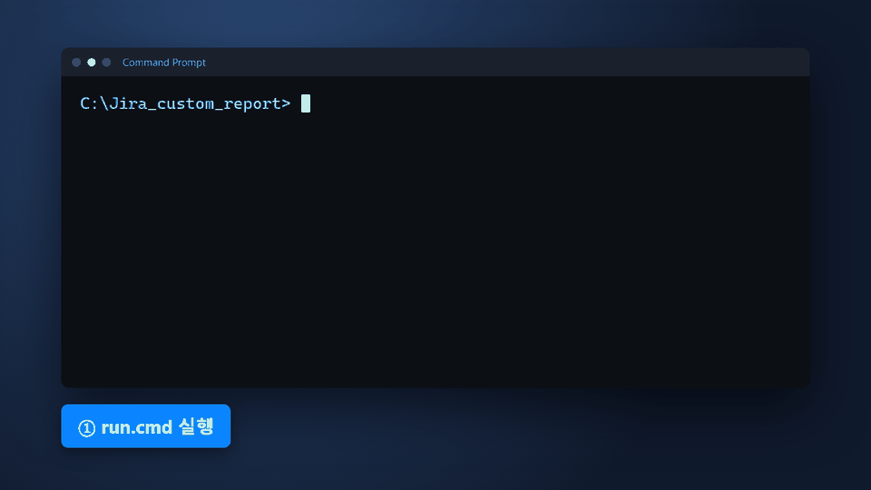

# Jira Custom Report

Local dashboard for Jira Server and Data Center issue trends.

See the [Quick Start Guide](QUICK_START.md) for screenshots.

<!-- showreel:start -->


Terminal scene is reconstructed from `run.cmd` output. Dashboard scene uses fictional demo data. To rebuild: `node tests/capture_showreel.cjs`, then `uv run --no-project --with pillow python tests/build_showreel.py`.
<!-- showreel:end -->

## Start

Requirements: Windows, Git, and [uv](https://docs.astral.sh/uv/). Put `uv.exe` in `tools/` or add it to `PATH`.

```bat
run.cmd --url https://jira.example.com/jira --id myuser
```

Enter the Jira password in the terminal. The dashboard opens in your browser. Leave the terminal open. Press **Ctrl+C** to stop.

Run without Jira:

```bat
demo.cmd
```

Demo uses fictional data. It needs no credentials and makes no Jira requests. See [Demo](#demo) for options.

## Dashboard

- Choose a year, projects, reporters, period, language, and theme.
- Project and reporter fields have autocomplete. Queries start when filters are valid.
- See combined totals and one graph per project.
- The regular report loads issues created or resolved in the selected year, then counts daily, weekly, monthly, quarterly, and yearly totals from that result.
- Choose **Cumulative** for year-to-date created and resolved lines, or **Non-cumulative** for created and resolved counts in each period.
- Choose **Unresolved trend** to replay each candidate issue's paginated Jira changelog and count issues with an empty resolution at each period end. This includes issues whose resolution has never changed, avoiding the known omission in `resolution WAS EMPTY ON "date"`. Jira must allow access to issue changelogs. The candidate-search JQL and changelog-replay note appear in each period's data-proof table; request volume depends on the number of candidate issues and changelog pages.
- Tables and CSV contain created/resolved period counts. CSV does not include unresolved snapshots.
- Demo mode supplies deterministic synthetic unresolved snapshots and makes no Jira requests.
- Export CSV or JPG to `outputs/`.
- Filters and display preferences are saved locally in `.local/inputs.json` and browser storage.

## Demo

```bat
demo.cmd
demo.cmd --no-open
demo.cmd --port 8765
```

Demo has twelve fictional projects and eight fictional users. Data is repeatable for a year and project. Demo settings are stored separately in `.local/demo-inputs.json`.

## Authentication and security

The Jira server must allow Basic authentication. SSO-only deployments need a separate authentication integration. Both HTTP and HTTPS URLs are supported, including custom ports and context paths. HTTPS certificate verification and redirect blocking remain enabled. An HTTP URL prints a warning because HTTP does not encrypt credentials in transit.

The password stays in server memory and is sent only to the configured Jira server. It is not placed in browser content, command arguments, files, or logs. The dashboard binds to loopback, validates browser requests against the expected host, origin, and session token, and does not expose a general filesystem or Jira proxy.

By default, enter the password at each launch. The optional **Auto login** control can save or remove the current Jira login in Windows Credential Manager after confirmation. When enabled, the saved login is used only for its associated Jira URL and user ID. Start with `--no-auto-login` to require a password for that launch.

## Development

```bat
dev.cmd
dev.cmd --no-open
dev.cmd --port 8766
```

`dev.cmd` uses demo data. HTML, CSS, or JavaScript edits reload the browser. Python edits under `cores/python/` restart the server. Default port is `8765`.

## Tests

```bat
uv run --locked python -m unittest discover -s tests -v
```

Some browser checks also need Node and Chrome. Tests use synthetic Jira data.

## Files

- `cores/python/` — Python app and server.
- `cores/html/` — HTML, CSS, and JavaScript.
- `docs/` — showreel and screenshots.
- `tests/` — unit and browser checks.
- `outputs/` — generated reports; ignored by Git.
- `.local/` — local settings and state; ignored by Git.
